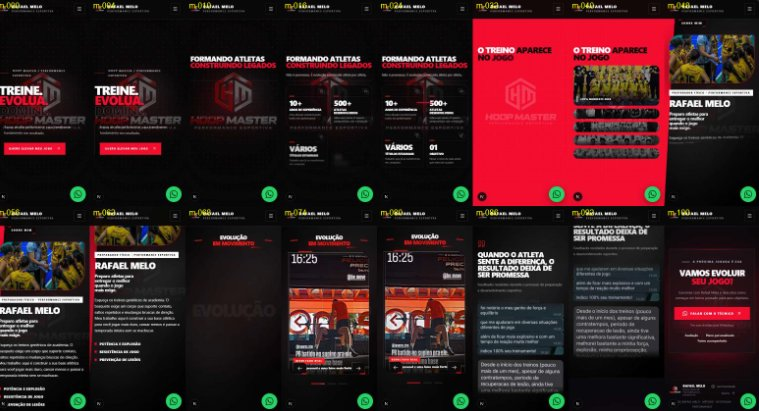

# 📱 Plano Detalhado: Versão Mobile (< 768px)

> [!IMPORTANT]
> **Regra de ouro: a versão web não muda.** Toda alteração fica isolada para telas menores que 768px:
> - **CSS/Tailwind:** só com o prefixo `max-md:` (ou classe base + `md:` devolvendo o valor atual do desktop).
> - **GSAP:** dentro de `gsap.matchMedia()`. A timeline atual do desktop passa a rodar com `(min-width: 768px)` e fica 100% idêntica.
> - **Prova:** antes de começar, foram capturados prints de referência do desktop (1440×900) em 16 pontos da rolagem. No final, compararemos pixel a pixel. Se algo mudar no desktop, nós revertemos imediatamente.

---

## 🔍 Diagnóstico: o que vimos no celular (390×844)

Rodei o site num iPhone simulado e tirei prints em 16 pontos da rolagem:

### Tabela de Problemas Encontrados na Auditoria

| # | Seção | Problema encontrado |
| :---: | :--- | :--- |
| **1** | **Arquitetura** | O site inteiro é uma única tela fixa (*pinned*) com ~9.600px de rolagem. Todas as cenas ficam empilhadas umas sobre as outras e o GSAP troca qual aparece. No celular isso gera rolagem longa, sensação de travamento e muito cálculo pesado por frame (`filter: blur`, scrub de 1.6). |
| **2** | **Hero** | O texto fica por cima do logo grande do fundo, poluindo a leitura. A palavra `"DOMINE."` quase some. |
| **3** | **Resultados** | Os 4 cards ficam espremidos em 2×2 e entram em cascata lenta, deixando a tela vazia enquanto não aparecem. |
| **4** | **Sobre mim** | **O conteúdo é mais alto que a tela e é cortado** (m-048 → m-062): a foto some em cima e os pilares de treino são cortados embaixo. |
| **5** | **Evolução (vídeos)** | O título *"Recorde pessoal…"* fica por cima das setas e dos indicadores. O card é grande demais para a altura útil da tela. |
| **6** | **Feedbacks** | Funciona, mas o título ocupa muito espaço vertical antes das colunas de depoimentos. |
| **7** | **CTA final** | *"Treino acompanhado"* quebra sozinho numa segunda linha. O botão flutuante do WhatsApp cobre o conteúdo no rodapé. |
| **8** | **Overflow** | Elementos decorativos passam da largura da tela (logo do fundo, glow de 50rem, logo do "Sobre mim"), podendo gerar rolagem lateral no iOS. |

---

## 📋 Seu Plano × O Que Já Existe no Código

| Item do seu plano | Situação Atual | Ajuste Proposto |
| :--- | :---: | :--- |
| **Menu `hidden md:flex`** | ✅ Já existe | Menu hambúrguer ativo abaixo de 1024px. Manter e refinar apenas o tamanho do header no mobile (`h-16`). |
| **Botão flutuante WhatsApp** | ✅ Já existe | Presente em `WhatsAppButton.tsx`. Ajustar para 56px, respeitar a *safe-area* e ocultar suavemente no rodapé para não duplicar com o botão do CTA. |
| **Opacidade marca d'água no rodapé** | ✅ Feito | Ajustado para 3,5% com texto de apoio em alto contraste/legibilidade. |
| **Trocar vídeo por foto** | ⚠️ Não há vídeo de fundo | Os vídeos são o próprio conteúdo principal da seção *"Evolução em movimento"*. Em vez de remover, carregaremos **somente o vídeo ativo**, com `preload="none"` e poster leve, tocando só quando visível. |
| **Priority no Hero** | ⚠️ Atualizado | No Next.js 16 o `priority` foi substituído por `preload`. O logo principal já usa. Vamos garantir que nada fora da tela seja pré-carregado. |
| **Desligar GSAP no mobile** | ⚠️ Decisão crítica | Como o site é montado em camadas absolutas sobrepostas, desligar o GSAP sem reestruturar deixaria todas as cenas empilhadas juntas. Por isso aplicaremos a **Opção A**. |
| **`flex-col-reverse`** | ✅ Aplicável | Na seção "Sobre mim": título, tag e nome virão antes da foto no mobile. |

---

## ❓ Decisão Estrutural de Rolagem no Celular

### 🟢 Opção A (Escolhida e Recomendada): Fluxo Natural no Mobile
- No celular, as cenas deixam de ser empilhadas numa tela fixa e viram **seções normais, uma embaixo da outra**:
  $$\text{Hero} \longrightarrow \text{Resultados} \longrightarrow \text{Galeria} \longrightarrow \text{Sobre mim} \longrightarrow \text{Vídeos} \longrightarrow \text{Feedbacks} \longrightarrow \text{CTA}$$
- As animações viram revelações leves ao entrar na viewport (*fade-in* + elevação suave de 20px, sem scrub pesado e sem blur), exatamente como solicitado.
- **Vantagens:**
  - ✅ Rolagem nativa, rápida e fluida sem cansaço de dedo.
  - ✅ Resolve em definitivo o corte do "Sobre mim".
  - ✅ O desktop continua 100% idêntico com o efeito imersivo de tela fixa (*storytelling*).

---

## 🚀 Fases de Execução Detalhadas

### Fase 0: Proteção & Segurança (Concluído)
- [x] Prints de referência capturados do desktop (1440×900 em 16 pontos de rolagem).
- [x] Branch isolada criada: `mobile-v1` (a `master` permanece intacta até aprovação).

### Fase 1: Arquitetura do Fluxo Mobile (`Hero.tsx`)
- Configurar `gsap.matchMedia()` com escopos limpos:
  - `(min-width: 768px)`: Mantém a timeline atual do Desktop **sem nenhuma alteração**.
  - `(max-width: 767px)`: Desativa o *pinning* e usa revelações simples com `ScrollTrigger.batch` (`once: true`).
- Adicionar classes `max-md:` nos containers principais:
  - Seção: `max-md:h-auto` (em vez de `1040svh`).
  - Sticky container: `max-md:static max-md:min-h-0 max-md:overflow-visible`.
  - Cenas absolutas: `max-md:relative max-md:inset-auto max-md:opacity-100 max-md:visible`.
  - Trilhos: `max-md:flex-col max-md:w-full max-md:h-auto`.
- Ajustar links de âncora do menu (`#resultados`, `#sobre`, `#depoimentos`) no mobile para rolarem para a posição física de cada bloco.

### Fase 2: Escala e Espaçamento (Apenas `max-md:`)
- **Paddings laterais:** `px-4` no celular (aproveitamento total da tela).
- **Espaçamento entre seções:** `py-12` a `py-16` para manter ritmo ágil.
- **Tipografia fluida:**
  - `h1` do Hero: `text-[clamp(2.4rem,11vw,3.2rem)] leading-[0.88]`
  - `h2` das seções: `text-[clamp(1.85rem,7.8vw,2.35rem)] leading-[0.95]`
  - Textos de apoio: mínimo de 14px com `leading-relaxed`.
- **Header:** altura otimizada de `h-16` com logo de 36px.

### Fase 3: Refinamento Seção por Seção
1. **Hero:** Logo de fundo posicionado sem sobrepor o título principal; botão de CTA com largura total e toque confortável (mínimo 48px de altura).
2. **Resultados:** Grid em formato vertical compacto (`grid-cols-1` ou `grid-cols-2` bem proporcionais), exibindo métricas sem telas vazias.
3. **Galeria de Campeonatos:** Accordion vertical interativo com expansão ao toque.
4. **Sobre Mim:** Reordenação com `flex-col-reverse` (identificação primeiro, foto depois), exibindo texto completo e os 3 pilares sem nenhum corte.
5. **Evolução (Vídeos):** Card proporcional `9:16` com altura máxima adaptada (`max-h-[68svh]`); controles e setas posicionados abaixo do vídeo, sem cobrir a legenda; ghost cards ocultos no mobile.
6. **Feedbacks:** Título enxuto com uma coluna contínua de depoimentos; lightbox em tela cheia com zoom mantido.
7. **CTA Final:** Passos de contratação organizados sem quebras de linha estranhas; botão flutuante do WhatsApp ocultado automaticamente ao entrar no rodapé.

### Fase 4: Performance e Economia de Bateria
- Carregar somente a mídia visível com `preload="none"`.
- Pausar ou desativar o canvas `DotField` em telas móveis.
- Substituir `filter: blur()` animado por transições de opacidade pura no mobile.
- Blindar contra rolagem horizontal indesejada com `overflow-x: clip`.

### Fase 5: Validação Rigorosa
- [ ] Teste visual responsivo em 390×844 (iPhone), 360×780 (Android) e 430×932 (iPhone Max).
- [ ] Comparação automatizada pixel a pixel do Desktop com a baseline da Fase 0 (**zero regressões**).
- [ ] `npm run build` validado com sucesso.
- [ ] Revisão prática no seu celular antes do merge final para a branch `master`.
